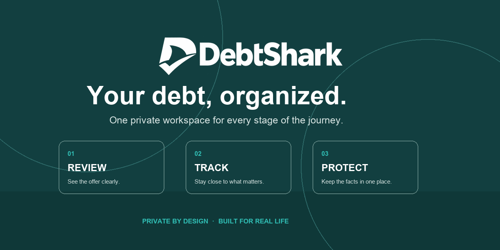

<p align="center">
  <a href="https://boredpolymath.github.io/DebtShark/"></a>
</p>

<h1 align="center">DebtShark</h1>

<p align="center"><strong>See the full picture before, during, and after a loan.</strong></p>

<p align="center">
  <a href="https://boredpolymath.github.io/DebtShark/"><strong>Try DebtShark ↗</strong></a>
  &nbsp;·&nbsp;
  <a href="#private-by-design">How privacy works</a>
  &nbsp;·&nbsp;
  <a href="./CONTRIBUTING.md">Contribute</a>
</p>

DebtShark is a calm, private workspace for understanding loan offers, planning repayment, keeping a servicing timeline, and organizing what happened if a problem needs attention. It is made for people—not lenders, collectors, or advertisers.

## Your debt, in clearer view

| Review an offer | Stay on top of repayment | Get organized when something goes wrong |
| --- | --- | --- |
| Turn loan amount, APR, term, and fees into a plain-language cost snapshot. Compare another offer before deciding. | Estimate payoff, record payments and notices, and keep optional reminders in one timeline. | Build a factual record, gather document references, track contacts and dates, and prepare a personal case packet. |

### One simple place for the whole lifecycle

1. **Review** the offer you received and identify questions worth asking.
2. **Repay and track** the loan once it is active, at your own pace.
3. **Resolve and protect** yourself with a clearer record if a servicing or collections issue arises.

## Private by design

DebtShark has no accounts, analytics, servers, cloud sync, ads, or tracking. The information you enter stays in the current browser on the current device. Exporting a case packet happens only when you choose it.

Because your data is local, clearing browser or site data, using private browsing, or changing devices can remove saved records. Keep an export of anything important.

## Use it your way

Open [DebtShark](https://boredpolymath.github.io/DebtShark/) in a current browser. On supported browsers, you can install it as an app; it also works directly in the browser and can continue working offline after its first visit.

DebtShark is designed for current Chrome, Edge, Safari, iPhone, and Android browsers.

## A note about guidance

DebtShark is educational planning and record-keeping support—not legal, financial, or tax advice. It cannot determine legal rights or deadlines, submit filings, or guarantee an outcome. If you receive court papers or face an urgent deadline, contact a qualified lawyer or legal-aid organization promptly.

## For contributors

DebtShark is a static web app. If you would like to help, start with the [contribution guide](./CONTRIBUTING.md), read the [code of conduct](./CODE_OF_CONDUCT.md), and use the issue templates for bugs or ideas. Security concerns belong in the [security policy](./SECURITY.md).

For a local preview:

```sh
python3 -m http.server 4173 --directory dist
```

Then visit `http://localhost:4173`.
